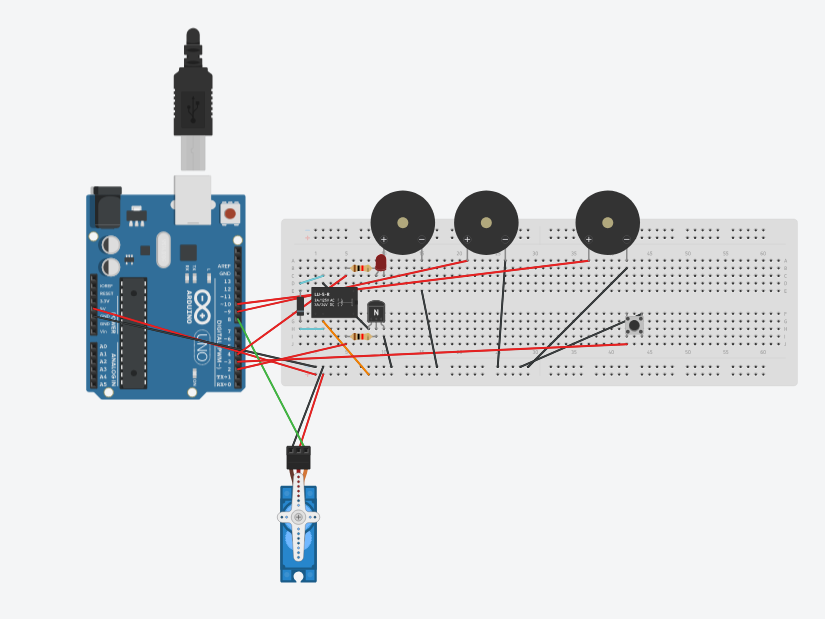

Music Box
3 buzzers + servo drum + relay ticking. Its mainly interesting because of the timing stuff we do to drive all the buzzers.

Code: [`chiptune_v2/chiptune_v2.ino`](chiptune_v2/chiptune_v2.ino). Timers: [`TIMERS.md`](TIMERS.md).

Demo (40 s): [`music_box_demo.mp4`](music_box_demo.mp4)

## Hardware
- Arduino Uno
- Passive buzzer + 1 kΩ + red LED (in series, LED blinks with the bass)
- 2 piezo discs
- Relay (Axicom D2n 5 V) + TIP120 + 1 kΩ + diode
- Servo
- Button

## Wiring



Schematic: [`scheme.pdf`](scheme.pdf) · parts: [`bom.csv`](bom.csv)


| Part | Pin | Wiring |
|---|---|---|
| Relay | D2 | D2 → 1 kΩ → transistor base, emitter → GND, coil 5 V ↔ collector, diode across coil (stripe on 5 V) |
| Button | D3 | → GND |
| Buzzer | D4 | D4 → 1 kΩ → LED → buzzer → GND |
| Servo | D8 | signal; power 5 V, GND |
| Disc 1 | D9 | → GND |
| Disc 2 | D10 | → GND |

In Tinkercad all 3 sound parts are "Piezo" (real: 1 passive buzzer + 2 discs), the relay is "Relay SPDT" (real: Axicom D2n 5 V) and the transistor is a generic NPN (real: TIP120).

## Build
```
arduino-cli compile -b arduino:avr:uno chiptune_v2
arduino-cli upload  -b arduino:avr:uno -p COM3 chiptune_v2
```
Serial: 115200 baud. No extra libraries.

## Use
- Starts paused. Button = play / pause.
- Serial: `press the button`, `pause`, `play from bar N`.
- Continues from the saved bar after a pause or power off.

New song: `python tools/gen_chiptune.py song.mid chiptune_v2/song.h`

## Song
- Bad Apple!! (Touhou), 145 BPM, 113 bars, ~3 min 7 s, then loops.
- MIDI source: TODO
- `tools/gen_chiptune.py` splits the MIDI: top note → melody, second note → harmony, lowest note (below C4) → bass. All played 1 octave up (`OCTAVE_UP 2`).
- Tables are `{NOTE_x, divider}` pairs (16 = sixteenth, 8 = eighth, negative = dotted), `REST` = silence. ~10 KB, stored in flash (`PROGMEM`).
- Drums: kick (relay) on beat 1, snare (servo) on beat 3 of every bar.

## Voices

| v | Table | Output |
|---|---|---|
| 0 | `bass` | buzzer D4, `tone()` |
| 1 | `melody` | disc D9, Timer1 A |
| 2 | `harmony` | disc D10, Timer1 B |
| 3 | `kick` | relay D2 |
| 4 | `snare` | servo D8 |

## Timers

| Timer | Set up by | Job |
|---|---|---|
| Timer0 | Arduino core (prescaler 64, `millis()`); we add `OCR0A = 128` + `OCIE0A` | interrupt every 1.024 ms: tick + servo pulses |
| Timer1 | us, registers: normal mode, prescaler 8 (2 MHz), `OCIE1A` / `OCIE1B`, `COM1A0` / `COM1B0` toggle | two notes at once on D9 / D10 |
| Timer2 | only `tone()` (no registers from us) | bass on D4 |
| INT1 | us: `EICRA ISC11` (falling edge), `EIMSK INT1` | button play / pause |

Timer0 decides **when** notes start and stop (`noteLeft` countdown). Timer1 and Timer2 only make the **pitch**.

## Timing budget

| Thing | Ticks | Time |
|---|---|---|
| Timer0 tick | 1 | 1.024 ms |
| Servo frame | 20 | ≈ 20.5 ms |
| Servo pulse up / down | 1 / 2 | ≈ 1 / 2 ms |
| Servo hit (stick down) | 80 | ≈ 82 ms |
| Relay click (coil on) | 30 | ≈ 31 ms |
| Gap before next note | 20 | ≈ 20 ms |
| One sixteenth at 145 BPM | 101 | ≈ 103 ms |
| One bar | 16 sixteenths | ≈ 1.66 s |
| Timer1 count | – | 0.5 µs |

## ISRs

| ISR | Does |
|---|---|
| `TIMER0_COMPA_vect` | `tick = true`, servo pulse |
| `TIMER1_COMPA_vect` | `OCR1A += melodyHalf` |
| `TIMER1_COMPB_vect` | `OCR1B += harmHalf` |
| `INT1_vect` | flip `paused`, ignore presses within 200 ms (bounce) |

ISRs only set values. Slow work (EEPROM, `seek()`, starting notes) runs in `loop()`.
`volatile` (touched by an ISR): `tick`, `servoPulse`, `melodyHalf`, `harmHalf`, `paused`, `lastPress`.

## EEPROM

| Address | Field |
|---|---|
| 0–1 | `magic` 0xF1A5 |
| 2 | `version` 5 |
| 3–4 | `bar` |

- Load: wrong `magic` / `version` or `bar` past the end → start from bar 0.
- Save: on every pause and every 16 bars.
- Play: `seek()` walks each voice's table to the saved bar (a held note plays only what is left of it).

## Limits
- Relay coil ≈ 30 mA (5 V / 167 Ω) goes through the TIP120, not the pin. D2 only drives the base through 1 kΩ (≈ 4 mA).
- Diode across the coil takes the voltage spike when the coil turns off, protects the TIP120.
- Buzzer path: 1 kΩ + LED ≈ 3 mA. Discs draw almost nothing.
- Servo powered from the Uno 5 V (USB).

## Tests
All the tests passed.

## Works / doesn't
All the 'instruments' work. Doesn't work we can't control loudness.
 
## Known issues
Piezzo buzzers are too quiet and cannot do bass. The servo is too loud, and doesnt work well overall. Relay sound is not good. The timings are not exact, since we do division on timer1. Overall the main issues are sound and also that we have hardcoded the songs.
