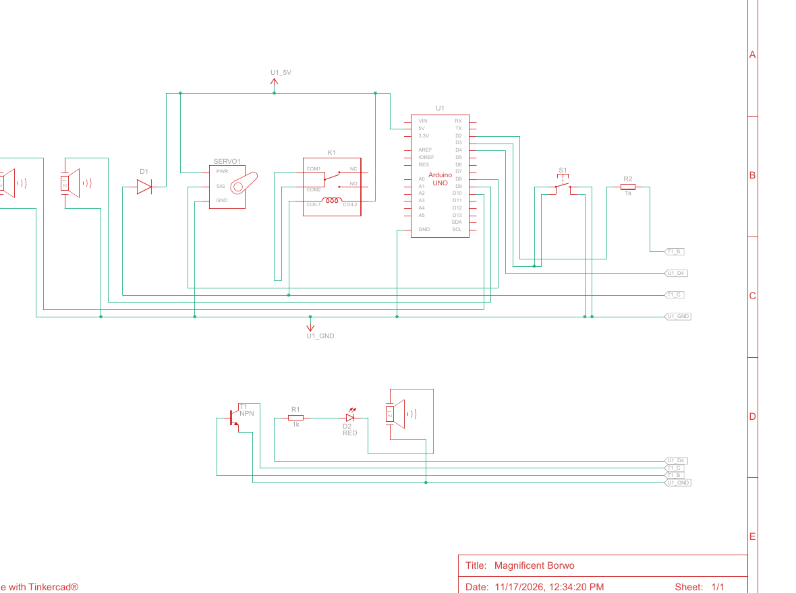

# HW3 — Music Box

TODO: what it is

Code: [`chiptune_v2/chiptune_v2.ino`](chiptune_v2/chiptune_v2.ino). Timers: [`TIMERS.md`](TIMERS.md).

Demo (40 s): [`music_box_demo.mp4`](music_box_demo.mp4)

## Hardware
- Arduino Uno
- Passive buzzer + 1 kΩ + red LED (in series, LED blinks with the bass)
- 2 piezo discs
- Relay (Axicom D2n 5 V) + TIP120 + 1 kΩ + diode
- Servo
- Button

## Wiring


Schematic: [`scheme.pdf`](scheme.pdf) · parts: [`bom.csv`](bom.csv)



| Part | Pin | Wiring |
|---|---|---|
| Relay | D2 | D2 → 1 kΩ → transistor base, emitter → GND, coil 5 V ↔ collector, diode across coil (stripe on 5 V) |
| Button | D3 | → GND |
| Buzzer | D4 | D4 → 1 kΩ → LED → buzzer → GND |
| Servo | D8 | signal; power 5 V, GND |
| Disc 1 | D9 | → GND |
| Disc 2 | D10 | → GND |

In Tinkercad all 3 sound parts are "Piezo" (real: 1 passive buzzer + 2 discs), the relay is "Relay SPDT" (real: Axicom D2n 5 V) and the transistor is a generic NPN (real: TIP120).

## Build
```
arduino-cli compile -b arduino:avr:uno chiptune_v2
arduino-cli upload  -b arduino:avr:uno -p COM3 chiptune_v2
```
Serial: 115200 baud.

New song: `python tools/gen_chiptune.py song.mid chiptune_v2/song.h`

## Voices

| v | Table | Output |
|---|---|---|
| 0 | `bass` | buzzer D4, `tone()` |
| 1 | `melody` | disc D9, Timer1 A |
| 2 | `harmony` | disc D10, Timer1 B |
| 3 | `kick` | relay D2 |
| 4 | `snare` | servo D8 |

## Timers

| Timer | Job |
|---|---|
| Timer0 | 1 ms tick + servo pulses |
| Timer1 | two notes on D9 / D10 |
| Timer2 | `tone()` bass on D4 |
| INT1 | button play / pause |

## ISRs

| ISR | Does |
|---|---|
| `TIMER0_COMPA_vect` | `tick = true`, servo pulse |
| `TIMER1_COMPA_vect` | `OCR1A += melodyHalf` |
| `TIMER1_COMPB_vect` | `OCR1B += harmHalf` |
| `INT1_vect` | flip `paused` |

## EEPROM

| Address | Field |
|---|---|
| 0–1 | `magic` 0xF1A5 |
| 2 | `version` 5 |
| 3–4 | `bar` |

## Tests
All the tests passed.

## Works / doesn't
All the 'instruments' work. Doesn't work we can't control loudness.
 
## Known issues
Piezzo buzzers are too quiet and cannot do bass. The servo is too loud, and doesnt work well overall. Relay sound is not good. The timings are not exact, since we do division on timer1. Overall the main issues are sound and also that we have hardcoded the songs.
